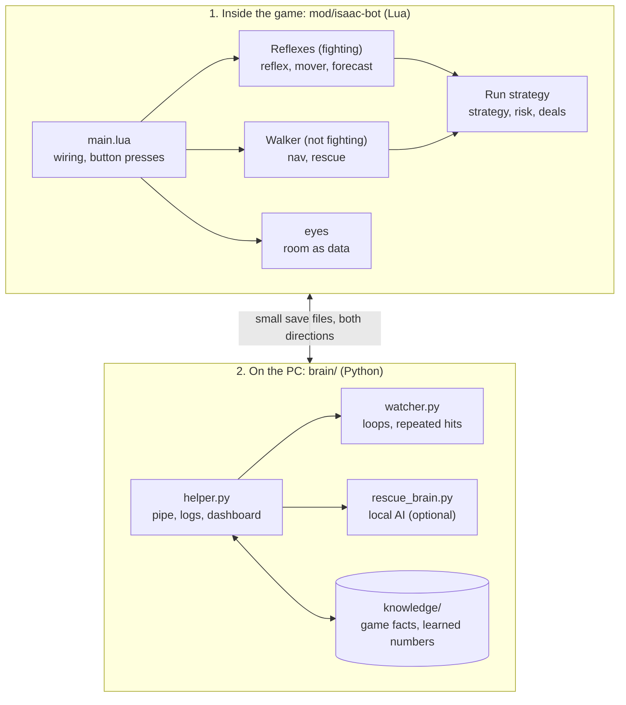

# Start here: the map of the project

One page: what the pieces are, where they live, how they talk, how to test without the game, and how a change gets in.
The *method* in full is in [HOW_WE_WORK.md](HOW_WE_WORK.md).

## The 30-second version

The bot is two programs that run side by side:

1. **A mod inside the game** (`mod/isaac-bot/`, Lua). It runs 30 times a second, looks at the room, decides where to
   move and shoot, and "presses" the buttons, like a controller would. All the playing happens here.
2. **A helper next to the game** (`brain/`, Python). It writes the logs, shows a live dashboard, sends knowledge files
   and commands into the game, watches for loops and repeated damage, and can ask a local AI model when the bot is
   stuck.

## Layers



### Inside the game (`mod/isaac-bot/`)

| Time scale | File | Job |
|---|---|---|
| Wiring | `main.lua` | The game's callbacks, button presses, menu autopilot, the pipe, settings |
| Every update | `reflex.lua` | Fighting: pick a target, aim, shoot; settings in `Reflex.S` |
| Every update | `mover.lua` | Movement core: search a few moves ahead for the safest path that still lines up a shot |
| Every update | `forecast.lua`, `cards.lua` | Predict where an enemy's body will be, from its "card" (`cards.lua` is generated, don't edit) |
| Every update | `tells.lua`, `danger.lua` | Learned attack wind-ups; one map of what hurts (spikes, creep, fires, bombs) |
| Twice a second | `roommap.lua`, `position.lua` | Pick a good spot to stand (new, behind the `position` setting while it's tested) |
| When not fighting | `nav.lua` | The walker: pathfinding, doors, floor map, pickups, bombs |
| When stuck | `rescue.lua`, `options.lua` | Escalate: replan, shake, bomb, leave, ask the AI |
| The whole run | `strategy.lua`, `risk.lua`, `deals.lua` | Which items and deals are worth it, and how much risk we can afford now |
| Data, not logic | `rules.lua` | The bot's judgement as numbers (what's worth a bomb or a hit) |
| Reporting | `eyes.lua`, `recorder.lua` | Pack the room for the helper; record enemy behaviour for research |

`eyes.lua` is for reporting: the reflexes and the walker read the game directly.

The other folders in `mod/` are small support mods: `isaac-bot-out` (carries messages to the helper),
`isaac-bot-data` (dumps the game's item data once per launch), `isaac-bot-bestiary` (dumps enemy data for research).

### On the PC

| Where | What |
|---|---|
| `brain/helper.py` | The main program: the pipe, `runs/live.log`, the dashboard, saving what was learned |
| `brain/watcher.py` | Spots loops and repeated hits, tries small per-enemy fixes, queues what needs code |
| `brain/rescue_brain.py` | Asks a local model (Ollama) to pick from a list of options when stuck |
| `brain/botconfig.py`, `tools/config.ps1` | Read `config.json` (your folder paths; never committed) |
| `knowledge/` | Data the bot reads: enemy playbook and cards, item ratings, boss tactics, learned numbers |
| `tools/` | Scripts for people: benchmarks (`bench.py`, `rooms.py`, `gauntlet.py`), `reload.ps1`, `look.py`, checks |
| `test/` | Offline tests (no game needed) |
| `runs/` | Logs and results from your own runs (never committed) |
| `docs/` | This page, the method, the plans, the research notes |

## How the mod and the helper talk

Isaac mods can't open network connections, but they can save small data files. That's the whole pipe:

- **Game → PC:** the mod calls `send(kind, text)`. The `isaac-bot-out` mod writes the newest messages (and the newest
  room snapshot) into its save file; the helper reads that file and handles each new message once.
- **PC → game:** the helper writes `number|command|payload` into the bot mod's save file; the mod checks it 10 times
  a second.
- **You → game:** put a line `command|payload` in `runs/send.txt` and the helper forwards it once. For example `map`,
  `reload`, or `set|key=value` to change a setting live.

## Run the tests without the game

`test/mock.lua` is a fake Isaac. `test/tests.lua` builds small rooms in it and runs the bot's **real** code.

```bash
# any OS (needs Python 3 and Lua 5.3 or 5.4: apt install lua5.3, or brew install lua)
python3 test/run.py             # every mod file compiles, then all the tests
python3 test/run.py --prove     # undo each fix in memory and check its test then fails
python3 test/run.py --only Host # only tests with "Host" in the name
```

```powershell
# Windows, with the game installed and no separate Lua: uses the game's own Lua (32-bit, so 32-bit PowerShell)
C:\Windows\SysWOW64\WindowsPowerShell\v1.0\powershell.exe -ExecutionPolicy Bypass -File test\run.ps1
```

`KNOWN` lines are real bugs that are written down but not fixed yet ([test/FOUND_BUGS.md](../test/FOUND_BUGS.md));
they don't count as failures. The Python tests are plain scripts: `python3 test/test_watcher.py` (and the other
`test/test_*.py`).

GitHub runs all of this on every push and pull request (`.github/workflows/ci.yml`): look for the green tick.

## How a change gets in

1. **Diagnose** with evidence: `runs/live.log` and saved frames. Say what's wrong before changing anything.
2. **Fix the category, not the room:** a general rule, with a comment saying why and when.
3. **Test it:** a scenario in `test/tests.lua` that fails without the fix, plus a `test/mutants.lua` entry.
4. **Reload safely:** `tools\reload.ps1` (Windows) or `bash tools/check.sh --reload` (Linux). Failing tests block it.
5. **Measure:** play the same locked set of rooms before and after (`tools/bench.py run`).
6. **Gate:** `tools/bench.py gate <before> <after>` must pass for any behaviour change.
7. **Commit**, naming what was compared. Then note it in [CHANGELOG.md](../CHANGELOG.md).

Why each step exists, with examples: [HOW_WE_WORK.md](HOW_WE_WORK.md).

## Where to read next

| You want | Read |
|---|---|
| Install and run it | [README.md](../README.md) |
| What it's aiming for | [ROADMAP.md](../ROADMAP.md) |
| Ideas waiting their turn | [BACKLOG.md](BACKLOG.md) |
| What changed, version by version | [CHANGELOG.md](../CHANGELOG.md) |
| Everything that was tried and measured | [HISTORY.md](HISTORY.md) |
| The current design work (cards and forecasts) | [FORECAST_PLAN.md](FORECAST_PLAN.md), [CARDS.md](CARDS.md) |
| The rules before you change code | [CONTRIBUTING.md](../CONTRIBUTING.md) |
